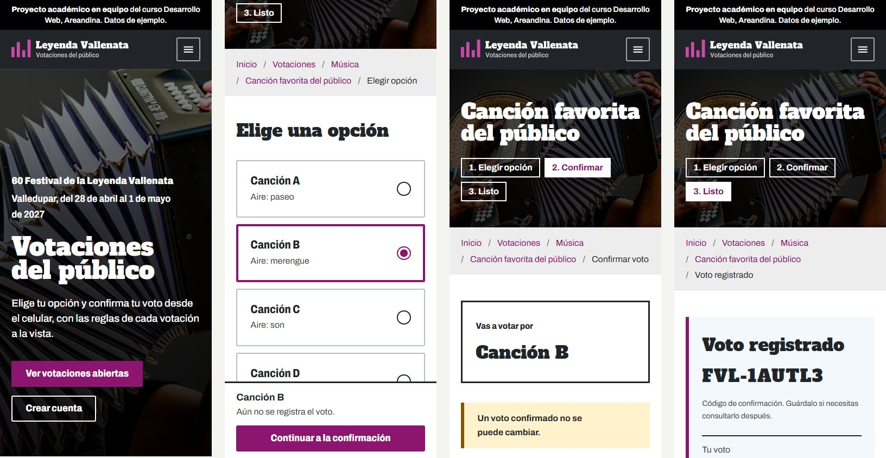
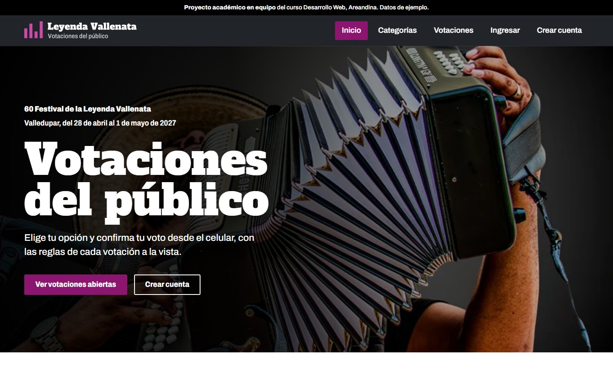

# Vallenata Festival Voting System

Interactive front-end prototype of a configurable public voting platform for the 60th Festival de la Leyenda Vallenata (Valledupar, Colombia, April 28 to May 1, 2027).

**Live demo:** https://jsanchez542-hub.github.io/vallenata-festival-voting-system/

It is part of a university team project for the Web Development course at Fundación Universitaria del Área Andina (first deliverable: analysis, design and prototype). The team wrote the analysis and design document together, and this prototype is its interactive counterpart. The brief was to analyze and design the platform before building it, so this prototype validates the flows and the interface, not the backend. The target stack for the real system is Django and MySQL.

This is an academic prototype. It is not an official site of the Fundación Festival de la Leyenda Vallenata, and all categories, polls and rules shown are sample data pending validation with the client.



## What it covers

The voter journey, on mobile first:

1. Browse the current edition, its categories and the polls (open, upcoming, closed).
2. Create an account, accepting the personal data policy, or sign in.
3. Read the rules of a poll, choose an option, confirm the vote and receive a receipt code.
4. See results when the poll allows it.

The administration area is a separate console with its own layout (dark sidebar, denser cards and tables, its own stylesheet) so it does not read as part of the public site:

- Editions and categories.
- Polls: dates, publication and rules.
- Options: add, edit, reorder and remove, with an optional image that is validated and resized in the browser.
- Results: totals, vote log, vote voiding and CSV export.

## The core idea: a configurable platform

The client has not defined most voting rules yet, so nothing is hard coded to a single vote. Every poll carries its own rule:

| Parameter | Options in the prototype |
| --- | --- |
| Votes per voter | 1 to 10 |
| Period | In total, or per day |
| Results visibility | Organization only, after close, or live |
| Registration | Required or not |

Two of the sample polls use different rules on purpose, so the difference is visible in the interface. Security rules from the analysis are applied too: passwords are stored as salted SHA-256 hashes, sign-in locks for two minutes after five failed attempts, administration pages require an administrator session, a confirmed vote cannot be changed and every administrative action is written to an audit log. Publishing a poll requires at least two options and a closing date after the opening date, and an option that already has votes cannot be renamed or removed.

## Design

The layout follows the editorial style of Colombia's official tourism pages: a dark navigation bar over a full-width photo banner, a light grey breadcrumb band under every banner, wide white content areas, a grey band for related content and a two-level grey footer. The palette is magenta for primary actions and links, blue for secondary actions and focus, and neutral greys, with no official logos or country branding. The home page opens with a full-width photo of an accordionist, the voting steps sit over a darkened photo of a jury panel, and navigation links fill with magenta on hover and on the current page.

- Logo: four vertical bars of alternating height, one for each vallenato rhythm (paseo, merengue, son and puya), which also read as a results chart. Built as outlined SVG from the site's own typefaces, with light, dark, white and black versions, favicon, touch icon and a social preview card.
- Typography: Alfa Slab One, a wood-type poster slab, for display, and Archivo with its condensed widths for the interface, both self-hosted.
- Mobile first from 320 px up, with generous spacing, a single left alignment and touch targets of at least 44 px.
- Light surfaces for reading and forms, dark surfaces for orientation.
- Sentence-case copy written for voters, with explicit error and empty states.



## Quality checks

- Automated accessibility audit with axe-core (WCAG 2.1 A and AA plus best practices): 0 violations across 15 views on mobile and desktop.
- Text over both photos measured against the brightest background pixel behind each line, at 390, 768, 1440 and 1920 px: at least 7:1 on the hero and 11:1 on the voting steps.
- No horizontal overflow from 320 to 1440 px.
- Valid HTML on all 15 pages (html-validate, recommended rules).
- No broken links or failed requests across every page and asset.
- ESLint passes with no errors (`npm run lint`).
- Keyboard navigation, visible focus and reduced-motion support throughout.
- No runtime dependencies, no build step and no external requests.

## Screens

| Screen | File |
| --- | --- |
| Home | `index.html` |
| Sign up | `sign-up.html` |
| Sign in | `sign-in.html` |
| Categories | `categories.html` |
| Polls | `polls.html` |
| Poll detail | `poll.html` |
| Options | `options.html` |
| Vote confirmation | `confirm.html` |
| Result and receipt | `result.html` |
| Admin dashboard | `admin/dashboard.html` |
| Editions and categories | `admin/categories.html` |
| Polls management | `admin/polls.html` |
| Options management | `admin/options.html` |
| Results | `admin/results.html` |

## Run it locally

No install is needed to view the prototype. Serve the folder with any static server:

```
npm start
```

or

```
python -m http.server 8080
```

Then open http://localhost:8080.

## Demo accounts

| Role | Email | Password |
| --- | --- | --- |
| Voter | votante@ejemplo.co | Votante2027 |
| Administrator | admin@ejemplo.co | Admin2027 |

The sign-in page has one-click buttons for both accounts, and every page links to it from the footer. You can also create your own voter account, and the footer has a button to restore the sample data.

## Project structure

```
assets/
  css/        Design tokens, base, layout, components, page styles and admin console
  fonts/      Self-hosted fonts
  img/        Photos, favicons and social preview card
    brand/    Logo and symbol in every color version
  js/
    data/     Seed, storage, authentication, poll rules and admin operations
    ui/       DOM helpers, layout chrome, forms, tables and views
    pages/    One module per page
admin/        Administration console pages
docs/         Screenshots
```

## Limitations

- State lives in the browser (`localStorage`), so data is per device and sample data resets after 14 days.
- Password hashing and the sign-in lock run in the browser because there is no server. The Django implementation will rely on its own password hashers and server-side rate limiting.
- Rules, categories and polls are examples. The open questions for the client are tracked in the project analysis document.

## Team and credits

Team project, Web Development course (group 202660-6A-62), Fundación Universitaria del Área Andina, 2026. The analysis and design document is the shared work of the team.

Prototype design and development, as the team's UX/UI and prototype lead: Miguel Sanchez Torres.

Fonts: Alfa Slab One and Archivo, both under the SIL Open Font License.
